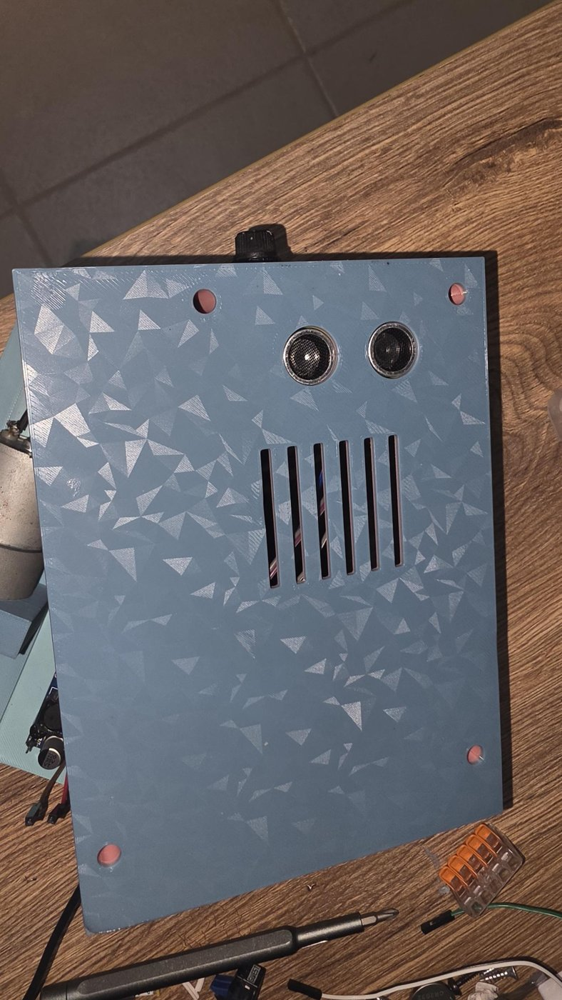
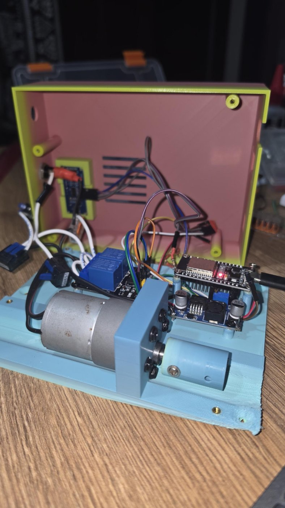
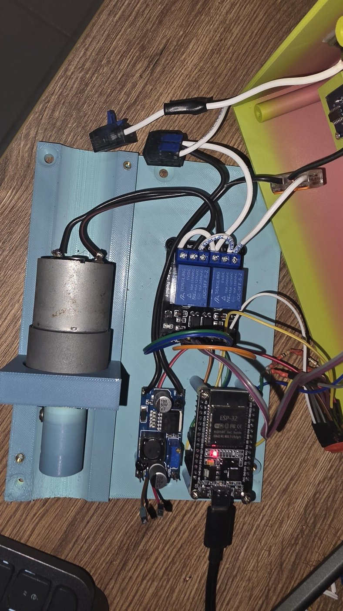
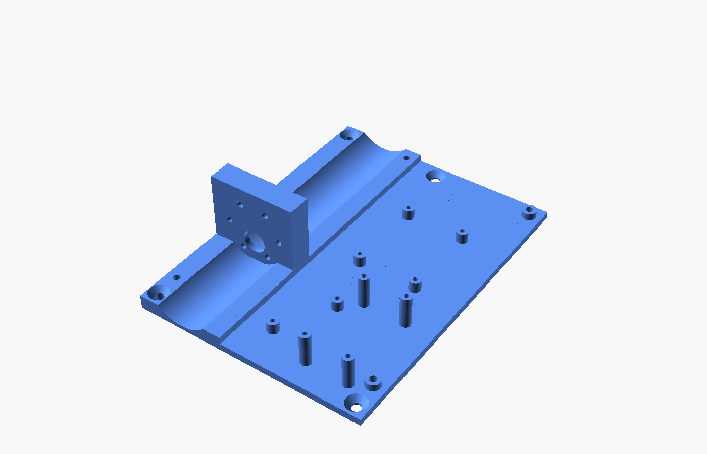
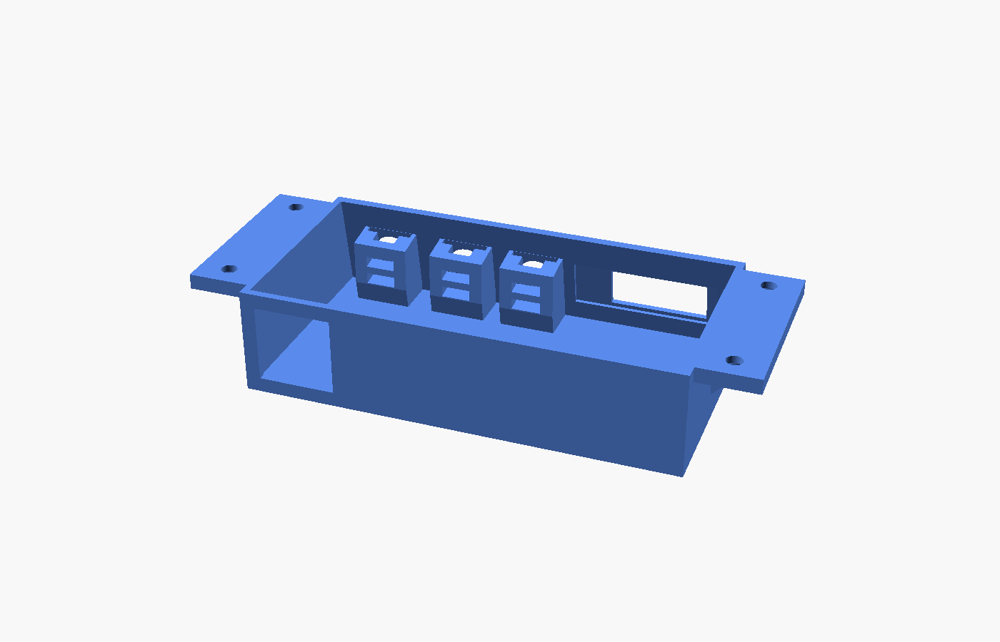
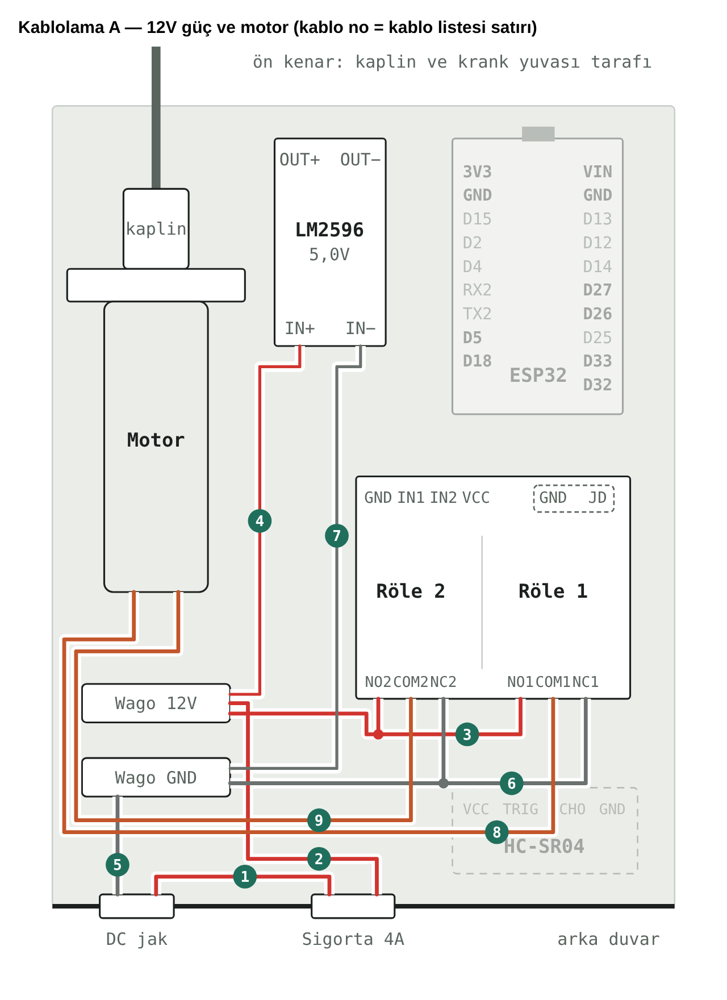
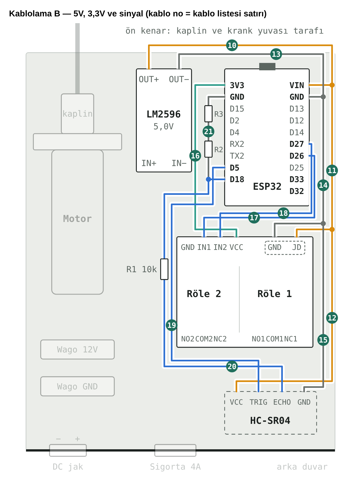

# IKEA TROTTEN / SKARSTA Motorized

**English** · [Türkçe](README.tr.md)

Motorize the hand-cranked **IKEA TROTTEN** (and **SKARSTA**, same hex crank input) sit/stand desk with an **ESP32**, a 12 V gear motor and a few cheap modules.
The desk is controlled from **Home Assistant** (via ESPHome) and from an optional **front button panel** with a small OLED that works even when Home Assistant or WiFi is down.

<p align="center">
  
  
  
</p>

## Features

- Replaces the crank: the motor turns the desk's 6 mm hex input through a printed coupler.
- **Height measured** with an HC-SR04 ultrasonic sensor pointing at the floor; the desk stops at its target height.
- **Home Assistant:** a `Desk` cover entity with position, live height sensor, 3 adjustable presets stored on the device.
- **Front panel (optional):** 0.91" OLED + ▲ ▼ ■ keys, connected to the main box over a standard RJ45 patch cable.
  Can be enabled/disabled from Home Assistant, so one firmware works with or without the panel.
- Works offline: never reboots when WiFi/HA is gone; 40 s safety timeout on every move.
- Everything (motor, boards, sensor) lives in one box under the desk; fuse and DC jack are accessible from outside.

## Bill of materials

### Electronics (main box)

| Qty | Part | Notes |
|---|---|---|
| 1 | ESP32-WROOM-32 DevKit, 30-pin | Any ESP32 dev board with this pinout; standoffs fit 24 × 47 mm hole spacing |
| 1 | 2-channel relay module, JQC-3FF-S-Z, **5 V coil**, optocoupler, with JD-VCC jumper | Used as the motor H-bridge (10 A contacts) |
| 1 | LM2596 step-down module (HW-411) | 12 V → **5.0 V** for ESP32, relay coils and HC-SR04 |
| 1 | HC-SR04 ultrasonic sensor | Height measurement, points at the floor |
| 1 | 12 V DC gear motor, 37 mm (JGB37-520 / 37GB555 family), 6 mm D-shaft | Replaces the hand crank |
| 3 | 10 kΩ resistor, ¼ W | ECHO voltage divider (5 V → 3.3 V) |
| 1 | 100 nF ceramic capacitor (optional) | Across the motor terminals, reduces noise |

### Power

| Qty | Part | Notes |
|---|---|---|
| 1 | 12 V power supply, **≥ 3 A** (5 A ideal), 5.5 × 2.1 mm plug | A laptop/LED supply works if it is 12 V ≥ 3 A |
| 1 | Panel-mount DC jack DC-022B, 5.5 × 2.1 mm (11 mm body) | Rear wall of the cover |
| 1 | Panel-mount 5 × 20 mm fuse holder (12 mm body) + **4 A** fuse | Rear wall of the cover, replaceable from outside |
| 1 + 1 | Wago 221 lever connectors: 3-way and 5-way | +12 V and GND distribution (a terminal block also works) |

### Front button panel (optional)

| Qty | Part | Notes |
|---|---|---|
| 1 | 0.91" OLED, SSD1306, 128 × 32, I2C (4-pin) | 38 × 12 mm board, 25 × 10 mm glass; the glass sits flush in the front window |
| 3 | 6 × 6 mm tactile switch, 4-pin, ~5 mm tall | ▲ ▼ ■ (measure height, see `sw_yukseklik` in `panel-box.scad`) |
| 2 | RJ45 keystone jack, Cat5e/Cat6 | One in the main cover, one in the panel. Holes are sized for the **Digitus tool-less keystone (20 × 20 × 36 mm)**; for a standard 14.9 × 16 mm punch-down keystone change `ks_delik` in `panel-box.scad` / `cover.scad` |
| 1 | Straight (T568B) patch cable, 1–1.5 m | Main box ↔ panel |

### Hardware

| Qty | Part | Used for |
|---|---|---|
| 4 | M3 heat-set inserts | Cover screw points in the base plate |
| 4 | M3 × 12 screws | Cover → base plate |
| 6 | M3 × 8 screws | Motor → motor mount |
| 10 | M3 or M2.5 × 6 screws | ESP32 (4), relay module (4), LM2596 (2) |
| 1 + 1 | M3 × 8 set screw + M3 nut | Coupler on the motor shaft |
| 4 | M2 self-tapping screws (or hot glue) | HC-SR04 on the spacer |
| 4 | 4 × 16 mm wood screws | Base plate → desk |
| 4 | 3.5 × 12 mm wood screws | Panel → desk front edge |
| 1 | 6 mm hex (Allen) key, ~6 cm cut from the straight part | Coupler → desk's hex input |

### Wiring and consumables

- 1 mm² red/black wire for 12 V and the motor; 0.5 mm² for the LM2596 input
- Female–female Dupont jumper set (signals), a few 4-pin Dupont housings for the removable cover
- Short coloured cores from an old Ethernet cable (keystone ↔ boards)
- Heat-shrink tubing, solder, a little hot glue

### Printed parts / filament

- About **250–300 g PETG** for everything (PLA is fine for the boxes, PETG recommended for the coupler)
- Largest parts are ~136 × 181 mm: needs a bed of at least ~200 × 200 mm
- Button caps: 2–3 colours with an AMS/MMU, or a single colour with a filament change

### Tools

- Soldering iron, multimeter (to set the LM2596 to 5.0 V before connecting anything)
- Heat-set insert tip (or the soldering iron), screwdrivers, calipers
- Keystone punch-down tool (for the panel)
- Hacksaw / angle grinder to cut the hex key

### Software

- Home Assistant with the ESPHome add-on (or ESPHome CLI), a USB-C cable for the first flash
- Chrome/Edge for web.esphome.io if you flash from the browser

## Printed parts

| File | What it is |
|---|---|
| `cad/main-box/body1-remix.stl` | Base plate: motor mount + standoffs for relay, LM2596 and ESP32 (remix of pashiran's Body1) |
| `cad/main-box/cover.stl` | Cover: HC-SR04 windows, vents, RJ45 keystone, USB, DC jack and fuse holes |
| `cad/main-box/hcsr04-spacer.stl` | Sits on the cover's pins inside, lifts the HC-SR04 so the transducers end flush with the cover |
| `cad/main-box/coupler.stl` | Motor shaft (6 mm D) ↔ desk hex (6 mm) coupler, M3 set screw |
| `cad/panel/panel-box.stl` | Front panel housing (OLED + 3 switches + RJ45), mounts under the desk's front edge |
| `cad/panel/button-caps-AMS.3mf` | Two-colour button caps for Bambu AMS (colours pre-assigned) |
| `cad/panel/ams/*.stl` | Same caps as separate bodies for any multi-material slicer |
| `cad/panel/button-caps-single-color.stl` | Single-colour version (pause at the colour-change height) |

All parts are parametric **OpenSCAD** files (`.scad`) next to the STLs; comments are in Turkish.
Print in **PETG** (PLA works for the boxes). Coupler: 100 % infill, printed upright.

<p align="center">
  
  
</p>

## Wiring

<p align="center">
  
  
</p>

### ESP32 pin map

| ESP32 | Connects to |
|---|---|
| VIN | LM2596 OUT+ (5 V), panel OLED VCC |
| GND | LM2596 OUT−, panel GND |
| 3V3 | Relay module VCC (opto side) |
| GPIO26 | Relay IN1 (up) |
| GPIO27 | Relay IN2 (down) |
| GPIO5 | HC-SR04 TRIG |
| GPIO18 | HC-SR04 ECHO via divider (below) |
| GPIO21 / GPIO22 | OLED SDA / SCL |
| GPIO32 / GPIO33 / GPIO25 | Panel ▲ / ▼ / ■ (other side of each switch to GND) |

**Relay H-bridge:** both NO contacts → +12 V, both NC contacts → GND, the two COM terminals → the motor leads.
With both relays released the motor is shorted (braked). Remove the JD-VCC jumper: **JD-VCC → 5 V**, **VCC → 3.3 V**, GND → common ground.
HC-SR04 VCC and the relay coils are powered from the LM2596 5 V output.

**ECHO divider** (the ESP32 is not 5 V tolerant):

```
ECHO ──[10k]──●──[10k]──[10k]── GND
              │
            GPIO18   (≈ 3.3 V)
```

**Panel cable (RJ45, T568B on both keystones, straight patch cable):**

| ESP32 | Wire colour | Panel |
|---|---|---|
| VIN (5 V) | orange | OLED VCC (the module has its own 3.3 V regulator; on 3.3 V it flickers. Its SDA/SCL pull-ups go to 3.3 V, so the ESP32 pins are safe) |
| GND | orange-white + green-white | OLED GND, common side of the 3 switches |
| GPIO21 | green | OLED SDA |
| GPIO22 | blue | OLED SCL |
| GPIO25 | blue-white | ■ STOP |
| GPIO32 | brown | ▲ UP |
| GPIO33 | brown-white | ▼ DOWN |

A full step-by-step guide (Turkish) with numbered wire list is in [`docs/guide-tr.html`](docs/guide-tr.html).

## Firmware (ESPHome)

- `firmware/trotten-desk.yaml`: English entity names
- `firmware/trotten-masa.yaml`: Turkish entity names

1. Copy `firmware/secrets.example.yaml` to `secrets.yaml` and put a fresh API key in it.
2. Set `min_h` / `max_h` to your desk's real lowest/highest height (cm).
3. Flash once over USB from the ESPHome dashboard (Home Assistant add-on) or `esphome run trotten-desk.yaml`.
   **Do not plug USB while the LM2596 feeds VIN.**
4. WiFi is entered during flashing (Improv) or via the `Trotten Desk` fallback access point.
5. Home Assistant discovers the device; enter the API key. Later updates go over WiFi.

### Home Assistant entities

| Entity | Purpose |
|---|---|
| `Desk` (cover) | Open = top, close = bottom, position slider = height |
| `Desk Height` | Live height in cm |
| `Preset 1/2/3` + `Go to Preset 1/2/3` | Adjustable, stored on the device |
| `Button Panel` (switch) | Enable the front panel once it is connected |
| `Restart` | Needed once after plugging in the panel so the OLED is detected |

### Front panel behaviour

- ▲ / ▼ short press: travel to top / bottom; any key stops.
- ▲ / ▼ hold: moves while held, stops on release.
- ■: always stops.
- OLED shows the height, a direction arrow, the target while moving, and `HA OK` / `NO HA` when idle.

## Calibration and troubleshooting

- Desk goes the wrong way → swap the two motor leads (or the two COM wires).
- Height reads `--.-` → check the divider tap is between the **first** and **second** resistor (≈ 3.3 V on GPIO18).
- Height offset → adjust `offset:` in the ultrasonic filter.
- OLED blank → `Button Panel` switch on? Press `Restart` after connecting the panel.
- OLED flickers → power it from 5 V (VIN), not 3V3. Check SDA–GND reads ~3.3 V with the ESP disconnected.

## Credits and license

- Base plate remixed from **pashiran**'s design, used in [flosommerfeld/ESP8266-IKEA-Skarsta-Trotten-Web-Dashboard](https://github.com/flosommerfeld/ESP8266-IKEA-Skarsta-Trotten-Web-Dashboard)
  ([Instructable](https://www.instructables.com/Motorizing-an-IKEA-SKARSTA-Table/)). The original `Body1.stl` is included in `cad/original/` for the remix to build.
- Firmware: MIT. 3D models: CC BY-NC-SA 4.0. See [LICENSE](LICENSE).

IKEA and TROTTEN are trademarks of Inter IKEA Systems B.V. This project is not affiliated with IKEA.
Modifying your desk is at your own risk.
